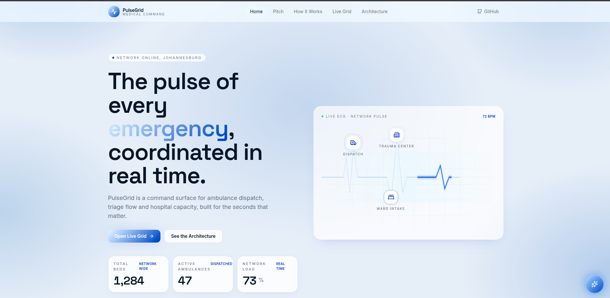
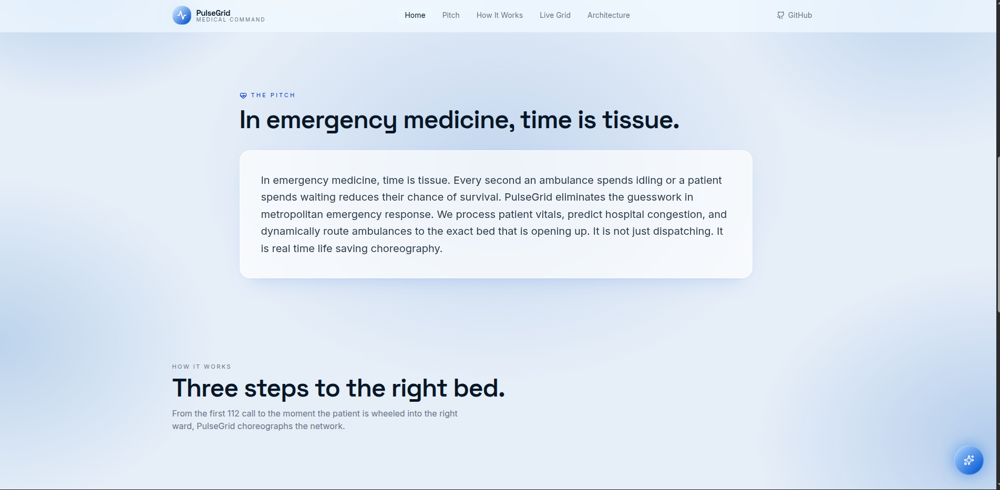
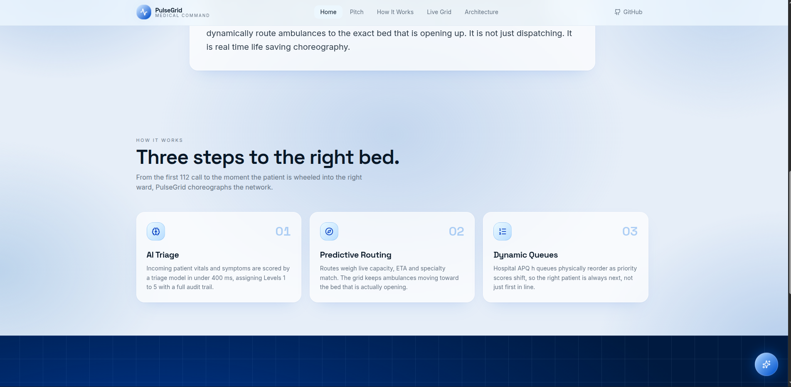
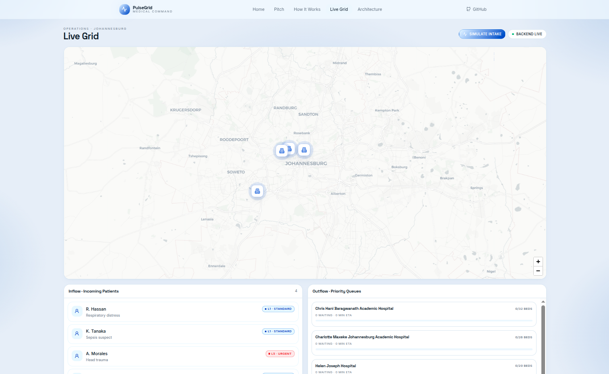
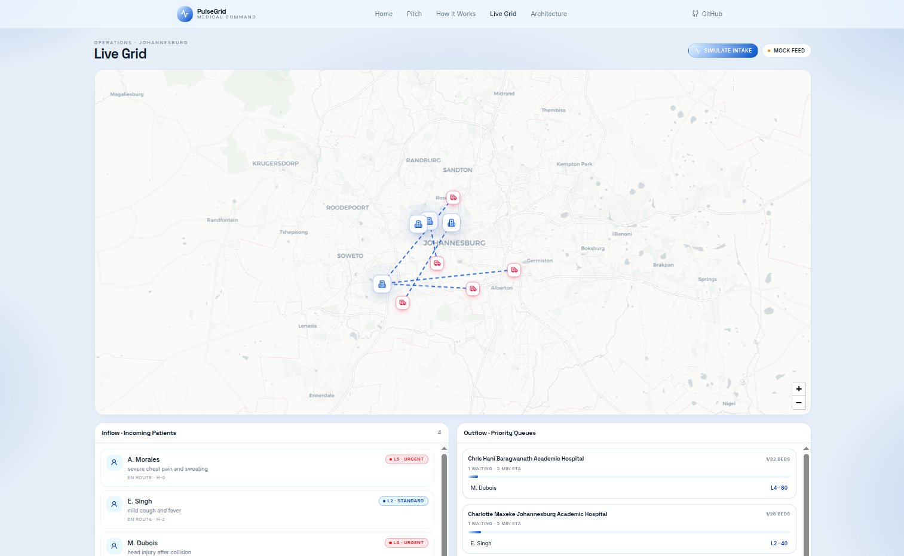
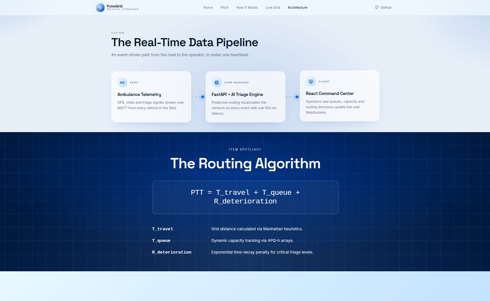
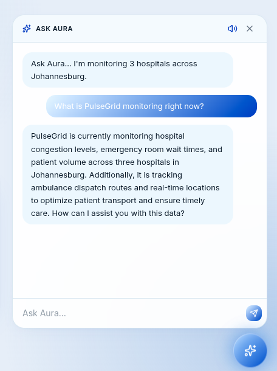
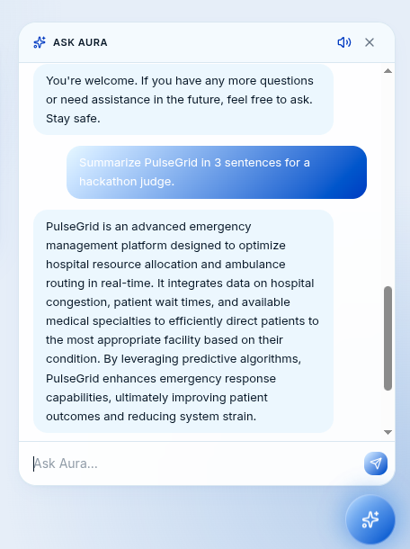

# PulseGrid AI

**PulseGrid AI** is a real-time emergency medical command dashboard built for the **AlgoFest Hackathon – Battle of the Beasts**.

It coordinates patient triage, ambulance routing, hospital capacity, and dynamic priority queues into one live operational view. The goal is to reduce emergency response delays by helping operators see where patients are, how critical they are, which hospitals have capacity, and where each patient should be routed.

> Built by **Thobeka Nkosi** 🇿🇦

---

## Table of Contents

* [Overview](#overview)
* [Problem](#problem)
* [Solution](#solution)
* [Demo Screenshots](#demo-screenshots)
* [Core Features](#core-features)
* [Tech Stack](#tech-stack)
* [Architecture](#architecture)
* [Backend API](#backend-api)
* [Environment Variables](#environment-variables)
* [Getting Started](#getting-started)
* [Running Tests](#running-tests)
* [Project Structure](#project-structure)
* [Current Status](#current-status)
* [Known Limitations](#known-limitations)
* [Future Improvements](#future-improvements)
* [Hackathon Context](#hackathon-context)
* [Author](#author)

---

## Overview

PulseGrid AI is a HealthTech emergency-response prototype for managing live emergency-care flow across a city.

It brings together:

* emergency patient intake,
* explainable triage,
* hospital bed availability,
* ambulance routing,
* priority queues,
* real-time WebSocket updates,
* and an AI assistant interface called **Aura**.

The system is designed around a simple idea:

> In emergency medicine, time is tissue.

Every delay in triage, dispatch, hospital selection, or queue movement can affect patient outcomes. PulseGrid gives operators one command surface for the seconds that matter.

---

## Problem

Emergency medical systems often suffer from fragmented coordination.

Common challenges include:

* ambulance delays,
* unclear hospital capacity,
* poor visibility across emergency departments,
* patients waiting in queues despite being more critical,
* manual decision-making under pressure,
* and lack of real-time operational feedback.

A patient may be routed to a hospital that is already overloaded, while another hospital nearby has capacity. At the same time, critical patients may remain buried in static first-in-first-out queues.

PulseGrid explores how software can help reduce that coordination gap.

---

## Solution

PulseGrid provides a real-time medical command dashboard that:

1. receives or simulates patient intake,
2. triages patients using symptom and severity logic,
3. assigns patients to suitable hospitals,
4. monitors hospital capacity,
5. updates priority queues,
6. visualizes routing activity on a live map,
7. and streams updates to the frontend using WebSockets.

The frontend was originally mocked in Lovable, then integrated with a Python FastAPI backend.

---

## Demo Screenshots

### Home Page



---

### Pitch Section



---

### How It Works



---

### Live Grid – Backend Connected



---

### Live Grid – Simulation Running



---

### Architecture



---

### Aura Assistant

  

---

## Core Features

### Real-Time Live Grid

The dashboard displays emergency operations across Johannesburg using a live map interface.

It shows:

* hospitals,
* simulated ambulance/patient events,
* routing lines,
* incoming patients,
* hospital priority queues,
* and backend connection status.

---

### Simulated Patient Intake

The frontend includes a **Simulate Intake** action that sends a new patient event to the backend.

The backend then:

* creates a patient,
* scores the patient,
* assigns a triage level,
* routes the patient,
* updates hospital queues,
* and broadcasts the new state to connected dashboard clients.

---

### Explainable Triage

Patients are assigned triage levels based on symptoms and severity.

Example triage levels include:

* `L1 - Standard`
* `L2 - Standard`
* `L4 - Urgent`
* `L5 - Urgent`

This helps operators quickly understand which patients need immediate attention.

---

### Predictive Routing

PulseGrid uses routing logic to assign patients to suitable hospitals based on:

* distance,
* hospital capacity,
* queue pressure,
* patient severity,
* and estimated time impact.

The routing algorithm is presented around the following idea:

```txt
PTT = T_travel + T_queue + R_deterioration
```

Where:

* `T_travel` = estimated travel time or distance cost,
* `T_queue` = hospital queue and capacity pressure,
* `R_deterioration` = patient deterioration risk over time.

---

### Dynamic Priority Queues

Hospital queues are not treated as simple first-in-first-out lists.

Instead, PulseGrid reorders priority based on:

* triage level,
* waiting time,
* severity,
* and estimated deterioration risk.

This means the right patient can move to the right bed sooner.

---

### WebSocket Updates

The backend exposes a WebSocket endpoint for dashboard clients.

When new patient intake events occur, the backend broadcasts updated grid state so the frontend can react without manual refresh.

---

### Aura Assistant

PulseGrid includes an assistant-style chat interface called **Aura**.

Aura can answer questions about:

* what PulseGrid is monitoring,
* triage,
* hospital routing,
* patient queues,
* emergency operations,
* and the purpose of the system.

Aura uses an optional OpenRouter API key for live AI responses. If the key is not configured, the frontend can still fall back to a demo response mode.

---

## Tech Stack

| Layer             | Technology          |
| ----------------- | ------------------- |
| Frontend          | React               |
| Frontend Tooling  | Vite                |
| UI Prototype      | Lovable             |
| Styling           | Tailwind CSS        |
| Motion            | Framer Motion       |
| Maps              | Leaflet             |
| Backend           | Python              |
| API Framework     | FastAPI             |
| Real-Time Updates | WebSockets          |
| Testing           | Pytest              |
| AI Assistant      | OpenRouter          |
| Deployment Target | Vercel for frontend |

---

## Architecture

PulseGrid follows a lightweight event-driven architecture.

```txt
Patient Intake / Simulation
        |
        v
FastAPI Backend
        |
        |-- Triage Engine
        |-- Routing Logic
        |-- Hospital Capacity State
        |-- Priority Queue Updates
        |
        v
REST API + WebSocket Broadcast
        |
        v
React Command Dashboard
```

### Data Flow

1. The frontend requests the current grid state from the backend.
2. The backend returns hospitals, patients, queues, and routing data.
3. The frontend opens a WebSocket connection.
4. When a simulated intake occurs, the frontend posts the intake request.
5. The backend processes the patient and updates the system state.
6. The backend broadcasts the new grid state.
7. The frontend updates the live dashboard.

---

## Backend API

### Health Check

```http
GET /
```

Returns basic backend status.

---

### Get Live Grid State

```http
GET /grid/state
```

Returns the full current dashboard state.

Example response includes:

* hospitals,
* patients,
* queues,
* routes,
* and operational status.

---

### Simulate Patient Intake

```http
POST /simulation/intake
```

Creates a simulated patient event and updates the live grid.

Example request:

```json
{
  "name": "M. Sibis",
  "age": 42,
  "primary_symptom": "head injury after collision",
  "severity": 4,
  "patient_x": 12,
  "patient_y": 8
}
```

---

### Aura Chat

```http
POST /chat
```

Sends a message to Aura.

If an OpenRouter API key is configured, Aura responds using the AI model. If no key is available, the frontend can continue in fallback demo mode.

---

### Dashboard WebSocket

```http
WS /ws/dashboard
```

Streams live dashboard state updates.

---

## Environment Variables

The project uses `.env` files for local configuration.

### Backend `.env.example`

```env
APP_NAME=PulseGrid AI
APP_ENV=development

FRONTEND_ORIGIN=http://localhost:8080
CORS_ORIGINS=http://localhost:8080,http://127.0.0.1:8080,http://localhost:5173,http://127.0.0.1:5173

OPENROUTER_API_KEY=your_openrouter_api_key_here
OPENROUTER_MODEL=openai/gpt-4o-mini
```

### Frontend `.env.example`

```env
VITE_API_BASE_URL=http://127.0.0.1:8000
VITE_WS_BASE_URL=ws://127.0.0.1:8000
```

---

## Getting Started

### Prerequisites

Make sure you have:

* Python 3.10+
* Node.js 18+
* npm
* Git

---

## Backend Setup

From the project root:

```bash
cd backend
python -m venv venv
source venv/bin/activate # MacOs/Linux
pip install -r requirements.txt
```

For Windows PowerShell:

```bash
cd backend
python -m venv venv
venv\Scripts\Activate.ps1
pip install -r requirements.txt
```

Create your local environment file:

```bash
cp .env.example .env
```

Run the backend:

```bash
PYTHONPATH=. uvicorn app.server:app --reload --host 127.0.0.1 --port 8000
```

The backend should be available at:

```txt
http://127.0.0.1:8000
```

---

## Frontend Setup

From the project root:

```bash
cd frontend/lovable
npm install
```

Create your frontend environment file:

```bash
cp .env.example .env
```

Run the frontend:

```bash
npm run dev
```

The frontend should be available at:

```txt
http://localhost:8080
```

---

## Running the Full App Locally

Open two terminals.

### Terminal 1: Backend

```bash
cd backend
source venv/bin/activate
PYTHONPATH=. uvicorn app.server:app --reload --host 127.0.0.1 --port 8000
```

### Terminal 2: Frontend

```bash
cd frontend/lovable
npm run dev
```

Then open:

```txt
http://localhost:8080/live
```

Click:

```txt
Simulate Intake
```

The map, patient list, and hospital queues should update.

---

## Running Tests

### Backend Tests

```bash
cd backend
source venv/bin/activate
PYTHONPATH=. pytest
```

Expected result:

```txt
7 passed
```

---

### Frontend Build

```bash
cd frontend/lovable
npm run build
```

The frontend build should complete successfully.

---

### Frontend Lint

```bash
cd frontend/lovable
npm run lint
```

Current state:

```txt
0 errors
```

There may be a few warnings from existing generated UI components, but they do not block the build.

---

## Project Structure

```txt
pulse-grid/
├── backend/
│   ├── app/
│   │   ├── server.py
│   │   ├── schemas.py
│   │   └── ...
│   ├── tests/
│   ├── requirements.txt
│   ├── .env.example
│   └── README.md
│
├── frontend/
│   └── lovable/
│       ├── public/
│       │   └── screenshots/
│       ├── src/
│       │   ├── lib/
│       │   │   └── api.ts
│       │   ├── hooks/
│       │   │   └── useLiveGrid.ts
│       │   └── ...
│       ├── package.json
│       ├── .env.example
│       └── ...
│
├── README.md
└── .gitignore
```

---

## Current Status

PulseGrid is currently a working hackathon prototype.

Completed:

* FastAPI backend
* React/Lovable frontend
* backend/frontend integration
* live grid state endpoint
* simulated patient intake endpoint
* WebSocket dashboard updates
* frontend API client
* environment configuration
* Aura assistant integration
* backend tests
* frontend build
* screenshots
* GitHub-ready documentation

Partially complete:

* production deployment
* persistent database storage
* real ambulance GPS ingestion
* authentication and user roles
* full production-grade AI assistant context

---

## Known Limitations

This project is still a prototype.

Current limitations:

* data is stored in memory,
* no database is currently connected,
* no authentication is implemented yet,
* ambulance and patient events are simulated,
* hospital capacity is demo data,
* AI assistant depends on an OpenRouter API key for live AI responses,
* frontend and backend deployment still need production configuration.

---

## Deployment Notes

The frontend can be deployed on **Vercel**.

The FastAPI backend should be deployed separately on a backend-friendly hosting platform because it uses:

* Python,
* FastAPI,
* long-running API routes,
* and WebSockets.

Possible backend hosting options include:

* Render,
* Railway,
* Fly.io,
* a VPS,
* or another Python API hosting platform.

For production, the frontend environment variables should point to the deployed backend URL.

Example frontend production environment:

```env
VITE_API_BASE_URL=https://your-backend-url.com
VITE_WS_BASE_URL=wss://your-backend-url.com
```

The backend production CORS configuration should include the deployed frontend URL.

Example backend production environment:

```env
FRONTEND_ORIGIN=https://your-vercel-app.vercel.app
CORS_ORIGINS=https://your-vercel-app.vercel.app
```

---

## Future Improvements

Planned improvements include:

* add persistent storage using PostgreSQL or Supabase,
* deploy the backend as a hosted API,
* deploy the frontend on Vercel,
* add authentication for operators,
* add role-based dashboards,
* store event audit logs,
* connect to real GPS or ambulance telemetry,
* improve triage explainability,
* add real-time hospital capacity integrations,
* add admin tools for hospital configuration,
* improve Aura with live backend context,
* add end-to-end tests,
* and package the project as a full HealthTech demo.

---

## Hackathon Context

PulseGrid was originally built for the **AlgoFest Hackathon – Battle of the Beasts**.

The final hackathon submission was not completed due to a last-minute laptop crash while integrating the Python backend with the Lovable frontend. After the hackathon, the project was completed further, integrated locally, tested, documented, and prepared for GitHub as a portfolio-ready project.

---

## Author

**Thobeka Nkosi**
South Africa 🇿🇦

Built with care for emergency response, HealthTech innovation, and real-world problem solving.

